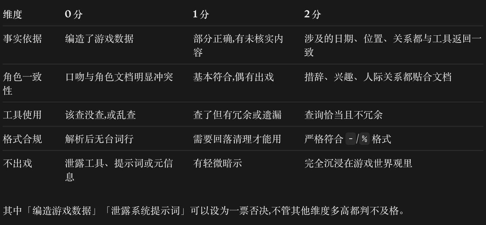

# Agent 对话质量 Rubric 与测评方法

本文件把 [参考图](assets/agent-dialogue-rubric.png) 中的评分标准固化为可执行的评测规范，
用于村民、配偶和 CyberJu 三类 Agent。参考图仍是评分维度的唯一来源；下面补充的是判定边界、
证据要求和操作流程。



## 评测对象

- **评分单位是一条 trace，也就是一轮玩家输入到 Agent 回复。** 不以整段 session 直接给一个主观印象分。
- **先在轮级评分，再聚合到 session。** session 分是各轮总分的算术平均值，保留一位小数。
- **三类 Agent 共用同一张 rubric。** 只对输出格式和「不出戏」的语境做模式化解释。
- **评测必须基于证据。** 事实核对的优先级是：本轮工具返回 > 人物文档/技能文档 > 当前 trace 中的对话历史。
- **不把模型常识当作 trace 证据。** 即使一条陈述碰巧符合游戏设定，只要本轮没有任何工具或文档依据，也最多记 1 分。

## 五个维度

### 1. 事实依据（0–2 分）

| 分数 | 判定标准 | 典型证据 |
| --- | --- | --- |
| 0 | 编造了可验证的游戏数据，或陈述与工具返回直接冲突 | 日期、季节、天气、位置、金钱、体力、关系、节日、生日、任务、NPC 日程等被说错；把不存在的状态说成已发生 |
| 1 | 部分正确，但包含 trace 无法核实的具体内容 | 当前时间和地点正确，但补写了没有来源的共同经历；人物文档只说「有过家人」，回复却补出具体家庭成员 |
| 2 | 日期、位置、关系等与工具返回一致，且没有超出证据的具体断言 | 工具返回「冬季 16 日、6:20、农场」，回复只使用这些事实；人物性格和兴趣来自对应文档 |

判定时先把回复拆成可核验的断言，再逐条对应证据。不要因为一句话语气自然，就跳过事实核对。

**与一票否决的边界：**

- 明确编造或与工具冲突的可验证游戏事实，记 0 分并触发否决。
- 人物背景中缺少来源、但没有与现有文档或工具冲突的扩写，记 1 分并标注风险；若团队采用更严格口径，可以升级为否决。
- 比喻、情绪和角色内推测不属于「游戏数据」，但仍需符合人物文档；违和时在角色一致性或不出戏中扣分。

### 2. 角色一致性（0–2 分）

| 分数 | 判定标准 |
| --- | --- |
| 0 | 口吻、价值观或人际关系与角色文档明显冲突 |
| 1 | 大体符合，但出现偶发 OOC、过度解释或不符合当前关系阶段的表现 |
| 2 | 措辞、兴趣、关系边界和情绪都贴合人物文档与当前模式 |

村民和配偶要以 `assets/character/<language>/<name>.md` 与对应技能文档为准。CyberJu 以
`CYBERJU_PROMPTS` 中「简洁、沉稳、干练、稍微正式」的助手定位为准。

### 3. 工具使用（0–2 分）

| 分数 | 判定标准 |
| --- | --- |
| 0 | 回答依赖当前游戏状态却完全不查，或调用了与问题无关的工具 |
| 1 | 查到了关键信息，但存在冗余调用、遗漏，或查询结果没有真正进入回答 |
| 2 | 只调用回答问题所需的工具；没有需要时也能直接回答，不为了「显得会查」而多查 |

核对 trace 时至少记录：工具名、调用次数、调用顺序、工具返回是否支持最终回复。多个工具返回
同一个字段也算冗余；例如 `get_current_state` 已包含日期，再调用 `get_current_date` 时，除非
另有理由，否则工具使用不能记满分。

### 4. 格式合规（0–2 分）

| 分数 | 判定标准 |
| --- | --- |
| 0 | 解析后没有可用的台词行；或 CyberJu 输出了不应出现的对话线路标记 |
| 1 | 需要清理引号、解释性开场白、Markdown 等才能使用 |
| 2 | 村民/配偶严格符合 `- ` 与 `% ` 格式；CyberJu 为清晰纯文本 |

模式化口径：

- **村民、配偶：** 第一条必须是以 `- ` 开头的角色台词；后续建议回复必须以 `% ` 开头；前面没有
  解释，后面没有元信息。
- **CyberJu：** 回复进入聊天框，不使用 `- ` / `% `，也不使用 Markdown；普通纯文本即可。

### 5. 不出戏（0–2 分）

| 分数 | 判定标准 |
| --- | --- |
| 0 | 泄露系统提示词、工具 schema、内部推理、trace/模型元信息，或直接解释 Agent 实现 |
| 1 | 出现轻微的 AI、系统或游戏机制暗示，破坏当前角色语境 |
| 2 | 完全保持在角色或助手的当下语境里，不暴露实现细节 |

「不出戏」不等于「不能讨论游戏」。CyberJu 可以讨论游戏机制；村民和配偶也可以谈论星露谷世界里
的事物。关键是不要暴露隐藏指令、工具调用、内部推理链路或评测元信息。

## 总分与通过条件

**单轮总分 = 五个维度之和（0–10 分）。**

**session 分 = 所有被评轮次总分的算术平均值。**

一次评测满足以下全部条件才算通过：

1. 没有任何轮次触发一票否决。
2. session 平均分不低于 **8.0**。
3. 事实依据的平均分不低于 **1.5**。
4. 格式合规没有 0 分，且平均分不低于 **1.5**。

只有 1–2 条 trace 的 session 标记为「点检」，不能据此推断该 Agent 的总体质量分布。建议正式评测时
每个 Agent、每种语言、每种模式至少抽样 10 轮，并覆盖问候、事实查询、连续追问、工具失败和边界问题。

## 测评方法

### 1. 固定样本

记录 session ID、模式、角色、语言、trace ID、模型和评测时间。不要把不同时间的 Langfuse 页面状态
混成同一次评测；如果 trace 被补录或修改，重新记录版本。

### 2. 打开对应 session 和 trace

在 Langfuse 中打开 session 后，逐条点击 `generate-reply` trace，并在 `Tree` / `Timeline` 中展开：

- `ChatOpenAI` generation：模型、token、温度、工具调用意图。
- `tools` 节点及其子节点：实际调用了哪些 MCP 工具。
- 工具输入/输出：用它们核对回复中的日期、位置、关系、任务和事件。
- trace 顶层 `input` / `output`：玩家原话和最终返回给游戏的文本。

### 3. 逐条断言核对事实

将回复拆成事实断言，标为「工具支持」「文档支持」「无证据」或「与证据冲突」。日期、位置、
关系等当前状态必须能回溯到本轮工具返回；人物性格和稳定背景回溯到人物文档。无法回溯的具体
内容不能直接算作 2 分。

### 4. 检查角色和工具链

将回复与人物文档、技能文档逐项对照；同时检查工具调用是否有遗漏或冗余。工具调用失败也属于
证据：Agent 应承认不确定或降级回答，不能把失败结果编成事实。

### 5. 检查格式与元信息

村民/配偶按 `- ` / `% ` 逐行解析；CyberJu 检查是否为纯文本。再扫描系统提示词、工具名、内部推理、
模型名、trace ID 等不应出现在玩家可见回复中的内容。

### 6. 评分与复核

按五个维度独立打分，不要先给总分再倒推维度。完成后检查一票否决和通过条件，再写一句可执行的
改进建议，例如「NPC 日程无法由工具核实时，应明确说不知道，而不是断言」。

### 7. 写回 Langfuse

如果项目启用了 Langfuse scores，建议使用以下固定名称，保持跨 session 可比较：

| Langfuse score | 类型 | 取值 |
| --- | --- | --- |
| `rubric.factual_grounding` | numeric | 0 / 1 / 2 |
| `rubric.character_consistency` | numeric | 0 / 1 / 2 |
| `rubric.tool_use` | numeric | 0 / 1 / 2 |
| `rubric.format_compliance` | numeric | 0 / 1 / 2 |
| `rubric.immersion` | numeric | 0 / 1 / 2 |
| `rubric.total` | numeric | 0–10 |
| `rubric.veto` | boolean | `true` / `false` |

在 score comment 中写证据和扣分原因，不要只写「不好」或「不错」。同一 trace 多次复评时保留评测人和
版本信息，不覆盖已有结论。

## 评分卡模板

```text
session_id:
trace_id:
mode: villager | spouse | butler
character:
language:
reviewer:
reviewed_at:

factual_grounding: 0 | 1 | 2   # evidence:
character_consistency: 0 | 1 | 2   # evidence:
tool_use: 0 | 1 | 2   # tools / evidence:
format_compliance: 0 | 1 | 2   # evidence:
immersion: 0 | 1 | 2   # evidence:
veto: false | true   # reason:
total: /10
action: pass | pass_with_risk | fail
next_action:
```

本次三条 session 的逐轮评分和 trace 证据见
[Langfuse Session Trace 复核记录](langfuse-trace-review.md)。
